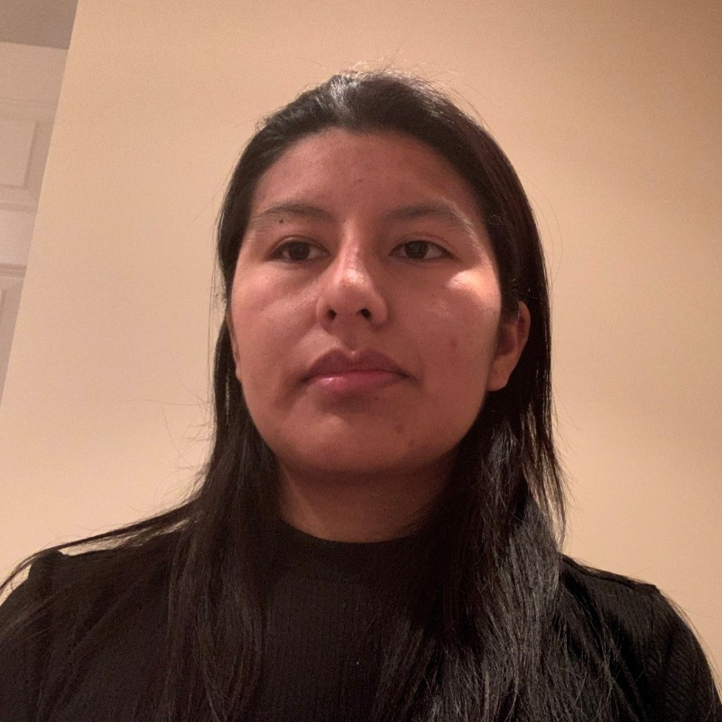

{: .profile-img}

I am a data engineer and tech enthusiast passionate about community building and diving into complex problems. I have experience with SQL and Snowflake, and I am currently learning more about AWS, WikiData and Rust. In my spare time I enjoy paper crafting and learning about universal history.

## Skills

**Programming languages:** Java, SQL, Python — Rust coming soon

**Tech stack:** Snowflake, AWS, Docker

## Contact me

-  LinkedIn: [Ana Maria Ruiz](https://www.linkedin.com/in/anamariaruizruiz)
-  GitHub: [salembo](https://github.com/salembo)
